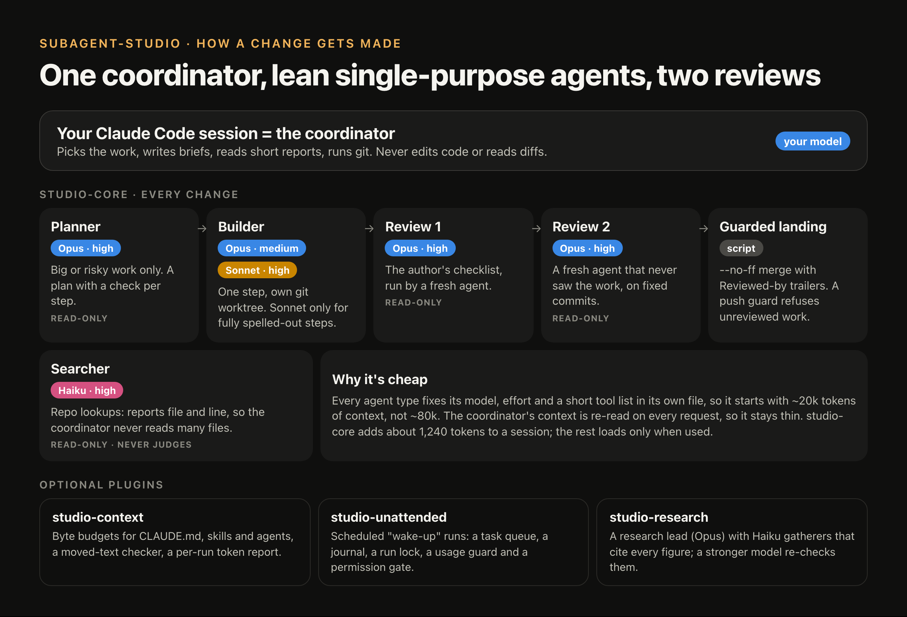
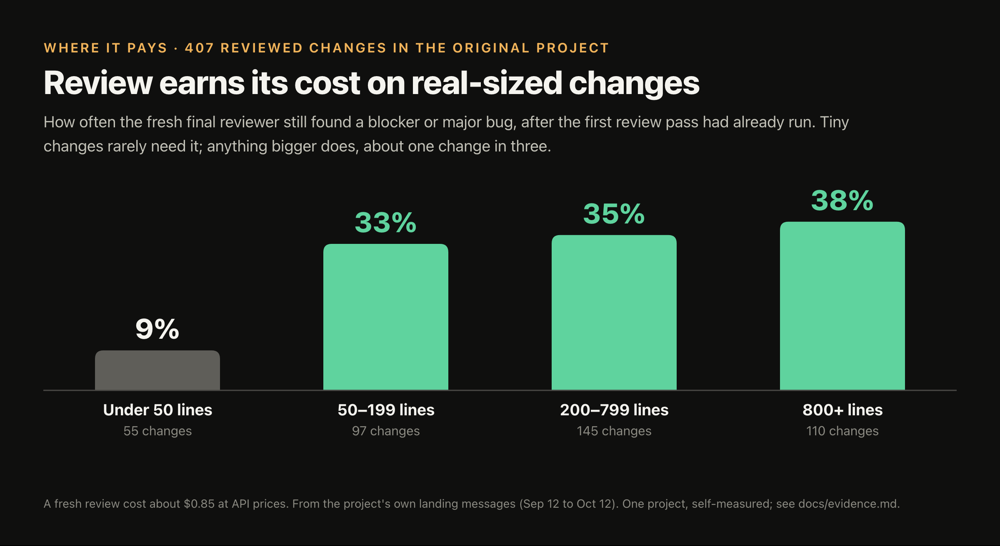
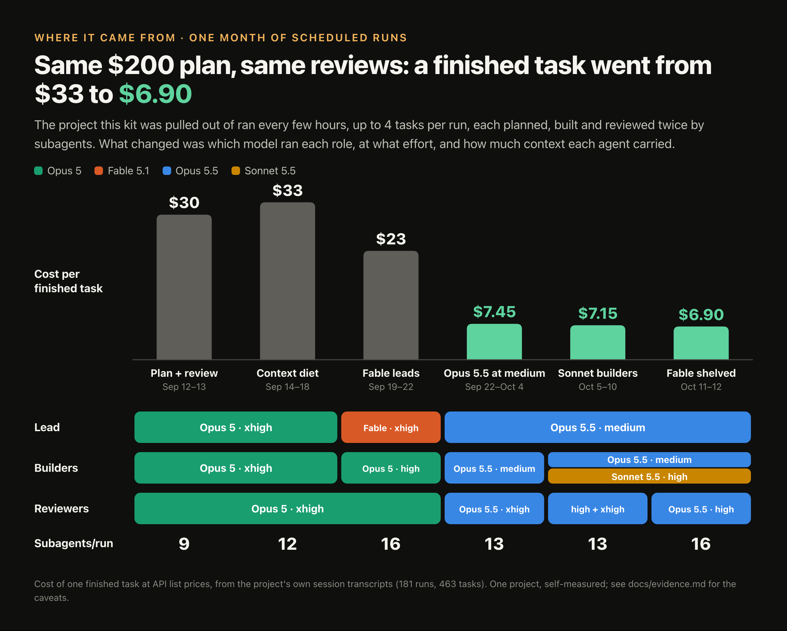
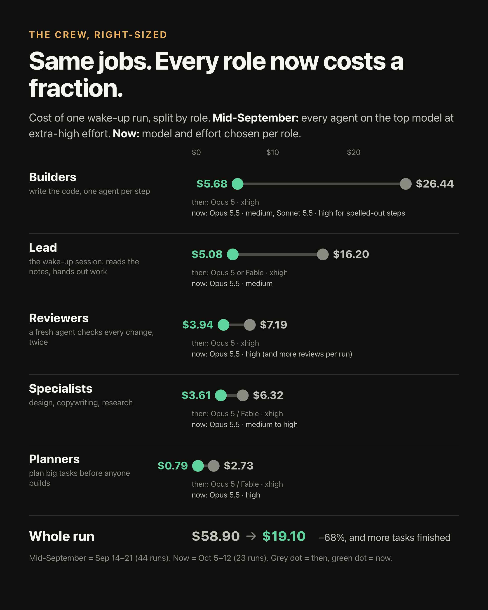
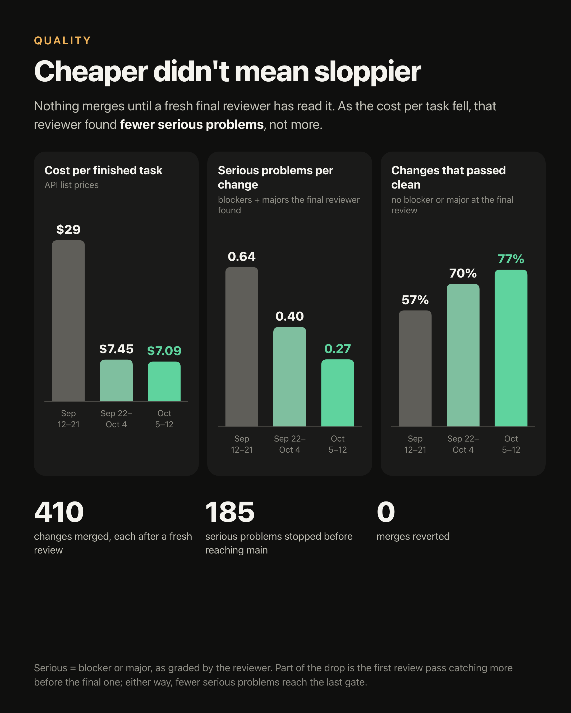
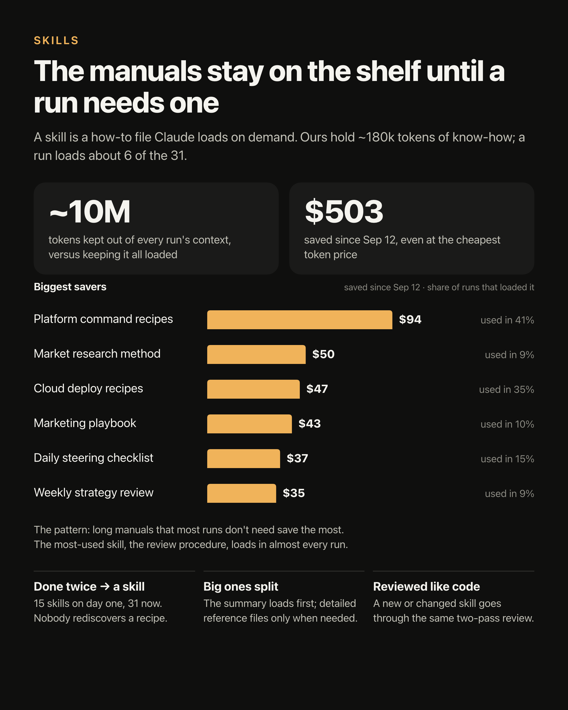

# subagent-studio

A set of Claude Code plugins that turn one session into an orchestrator running lean, single-purpose subagents:
plan first, build in a worktree, two review passes, enforced landing.
Pulled out of a real project that ran mostly on scheduled Claude Code sessions for about five weeks.



## When to use it

**Use it on medium-sized and larger codebases where changes are complex**:
several files per change, real users, code you will keep for years, or
scheduled runs that change things while nobody watches. That is where an
independent review keeps paying. In the original project the fresh final
reviewer still found a blocker or major bug in about one change in three,
after the first review pass had already run.



**Skip it for small, well-specified work.** A single Claude Code session
handles a small script or a precisely described feature in a small codebase
well, at a fraction of the cost. The kit adds a planner, builders, step
checks and two reviewers per change, which is several times the tokens of
one session doing the same work. On a tiny change that rarely buys anything
(9% in the chart above); on a real-sized one it buys a second pair of eyes
that catches what the first missed.

## The six ideas

**1. One agent type per role.** A builder, a reviewer, a planner and a
searcher are separate agent files. Each one fixes its model, its effort level
and a short tool list in its frontmatter. A reviewer gets no Edit or Write, a
searcher gets four read tools. A lean type starts with a fraction of a
general-purpose agent's context, and the role cannot drift into another role's
job.

**2. The orchestrator never touches code.** The main session picks the work,
writes briefs, reads short reports, decides and runs the git commands for
branches and landings. It never edits code, runs a test suite or reads a diff:
it reads `git diff --stat`. Its context is re-read on every request, so
keeping it small is the cheapest saving there is.

**3. Plan first for big work.** A new module, a big feature or anything hard
to reverse starts with a read-only planner that returns a plan in a fixed
shape. The session saves it to `plans/<slug>.md` and commits it before any
builder starts. Work that is hard to reverse, or both complex and critical,
goes to `planner-max`; every other plan goes to `planner`. Each plan step then
goes to its own fresh builder.

**4. Two review passes, then an enforced landing.** Every change to a reviewed
path lives on a review branch in its own worktree. Pass one is the author's
checklist, run by a fresh `reviewer-pass-one`. Pass two is a fresh `reviewer`
that did not write the change, reading fixed `BASE..HEAD` commits. Blockers
and majors get fixed, each with a test, and the branch lands by a `--no-ff`
merge carrying `Reviewed-by:` and `Fixed-after-review:` trailers. A guard
script refuses a push to main that carries unreviewed work. An optional hook
runs that guard automatically, and an audit walks main's history to find any
landing that slipped past.

**5. Cheap models read and never judge.** Haiku agents look things up in the
repo and read web pages for research. They never build, review, plan or decide
a finding, and the figures they bring back are re-checked by a stronger model
before a conclusion rests on them.

**6. Context is a budget.** `CLAUDE.md`, the state file, the task index, each
skill and each agent file have a byte budget. When a file grows past it, text
moves out word for word behind a stub. It is never deleted, and a script
proves that nothing was lost in the move.

## Quickstart (plugins)

```
/plugin marketplace add priyanshujha/subagent-studio
/plugin install studio-core@subagent-studio
/studio-core:studio-init
```

`studio-init` detects your check commands, proposes the reviewed paths, asks
about review passes, landing and the push hook, writes `.claude/studio.json`
and adds a short block to `CLAUDE.md`.

Then give it a first task:

```
Plan and build X with studio-core:plan-then-build
```

Add the other plugins the same way (`studio-context@subagent-studio`,
`studio-unattended@subagent-studio`, `studio-research@subagent-studio`).

## Quickstart (copy-in)

For a Claude Code build without plugin support, or if you would rather keep
everything in your repo:

```bash
git clone https://github.com/priyanshujha/subagent-studio && cd subagent-studio
./install.sh --modules core --target /path/to/project
```

`install.sh` copies agents and skills into `.claude/`, scripts into
`scripts/studio/` and hooks into `.claude/settings.json` (merged, never
overwritten). It rewrites the namespaced names (`studio-core:builder` becomes
`builder`). Options: `--modules core[,context,unattended,research]`,
`--dry-run`, `--force`, `--uninstall`. Then run the `studio-init` skill in the
project.

## The modules

| Plugin | What it adds | Depends on | Config section |
|---|---|---|---|
| `studio-core` | agents `builder`, `builder-sonnet`, `reviewer`, `reviewer-pass-one`, `planner`, `planner-max`, `searcher`; skills `plan-then-build`, `self-review`, `orchestrator-rules`, `studio-init`, `effort-low/medium/high/xhigh`; scripts `review_guard.sh`, `review_path.py`, `worktree_sweep.sh`; an optional push hook | nothing | `core`, `roles` |
| `studio-context` | skill `context-budget`; scripts `context_budget.py`, `check_moved_text.py`, `token_usage.py`, `effort_check.py`, `my_context.py` | nothing | `context` |
| `studio-unattended` | skills `wake-up`, `task-queue`, `journal`, `usage-guard`, `notify`; scripts `wake_lock.sh`, `notify.sh`; a permission gate and a prompt alarm hook | `studio-core` | `unattended` |
| `studio-research` | agents `research-lead`, `gatherer`, `gatherer-browser`; skill `research-run` | `studio-core` | `research` |

Every key is optional and has a default. The schema is
`config/studio.schema.json`, an example is `config/studio.example.json`, and
each module page under `docs/modules/` lists its keys.

## What a run looks like

Say the task is "add CSV export". The session (with `studio-core` installed)
does this:

```
1. Agent { subagent_type: "studio-core:planner", description: "Plan T-12",
           prompt: <task, constraints, files to read, the plan shape> }
   -> saves plans/t-12-csv-export.md, commits and pushes it

2. git worktree add -b review/2026-10-13-t-12-csv ../project-review/t-12-csv origin/main

3. Agent { subagent_type: "studio-core:builder", description: "Build T-12 step 1",
           prompt: <step 1 verbatim, goal, worktree path, ci_commands> }
   Agent { subagent_type: "studio-core:reviewer", description: "Check T-12 step 1",
           prompt: <acceptance line, builder report, the five checks> }
   ... one fresh builder and one fresh check per step

4. commit by path, push the branch, write down BASE and HEAD

5. Agent { subagent_type: "studio-core:reviewer-pass-one", description: "Pass one T-12",
           prompt: <branch, BASE..HEAD, paths, the author's checklist> }
   -> a fresh builder fixes what it found; new HEAD

6. Agent { subagent_type: "studio-core:reviewer", description: "Review T-12 before main",
           prompt: <reviewer-prompt.md, every placeholder filled> }
   -> a fresh builder fixes blockers and majors, each with a test; tip FIX

7. git merge --no-ff from a detached origin/main in the worktree, push HEAD:main,
   remove the worktree, delete the branch on both sides
```

The landing commit message ends with:

```
Reviewed-by: fresh reviewer agent, 3f1c2a9..8be04d1, 1 round (0 blocker, 1 major, 2 minor; 2 fixed, 1 queued)
Fixed-after-review: author, 8be04d1..c47e9f0, 2 fixes (major: empty file gave a header-only CSV; minor: column order)
```

`review_guard.sh audit` reads those two ranges and checks that the merge
brought in exactly what they cover. When `roles.<role>` in the config sets a
model or an effort level, the session passes it on that role's Agent call.
`examples/` builds a toy repo with one such landing that you can audit
offline.

## Details

**It costs more agent calls per change.** A small change takes a builder, a
pass-one reviewer and a fresh reviewer; a planned one adds a planner and a
check per step. Set `core.review.reviewed_paths` so that scratch directories
and throwaway scripts are not reviewed paths.

**Solo landing or pull requests.** The default, `core.review.land:
merge-no-ff`, has the session land reviewed work on main itself, which suits
one person running Claude Code. Teams that want a human to merge set
`core.review.land: pr`: the session opens a pull request whose body carries
the same trailers, and the pull request must be merged with a merge commit
that keeps them, so the audit still works.

**Claude Code version.** The plugin install needs a Claude Code build with
plugin and marketplace support; older builds can use `install.sh`. Passing
`model` and `effort` per Agent call, which the skills do when `roles` sets
them, needs a recent build (v2.1.292 or later). On older builds leave `roles`
empty and each agent file's frontmatter decides.

## Results from the original project

One project, one month of scheduled runs, measured from its own session
transcripts and git history. Read [`docs/evidence.md`](docs/evidence.md) for
the caveats before quoting any of it.

**The same plan-build-review loop got about 5x cheaper per finished task**
once each role ran on the right model and effort, with a lean context:



<table>
<tr>
<td width="33%"></td>
<td width="33%"></td>
<td width="33%"></td>
</tr>
<tr>
<td><b>Every role got cheaper.</b> The whole run fell from $58.90 to $19.10.</td>
<td><b>Quality held.</b> The final reviewer found fewer serious problems as cost fell; 0 merges reverted.</td>
<td><b>Skills load on demand.</b> About 6 of 31 per run, the rest stay out of context.</td>
</tr>
</table>

## Documentation

- [`docs/concepts.md`](docs/concepts.md): the six ideas in depth, with the
  failure behind each.
- [`docs/adopting.md`](docs/adopting.md): putting the kit into an existing
  project, step by step.
- [`docs/modules/core.md`](docs/modules/core.md),
  [`context.md`](docs/modules/context.md),
  [`unattended.md`](docs/modules/unattended.md),
  [`research.md`](docs/modules/research.md): what each plugin adds and every
  config key it reads.
- [`docs/evidence.md`](docs/evidence.md): what the original project measured,
  caveats first.
- [`docs/faq.md`](docs/faq.md): short answers.
- [`examples/README.md`](examples/README.md): the toy repo.
- [`CONTRIBUTING.md`](CONTRIBUTING.md), [`CHANGELOG.md`](CHANGELOG.md).

## License

MIT. See [`LICENSE`](LICENSE).
